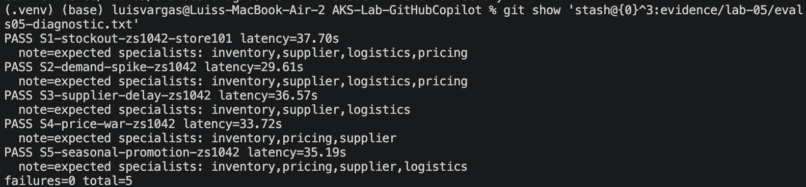

*THIS IS ALSO IN LAB4 README.md*
## Lab 05 — Execution Results and Evidence
### Azure deployment
ZavaShop was deployed through GitHub Actions to Azure Container Apps
and AKS. All eight Container Apps reported `Succeeded` and `Running`
with image tag `bae311b`. The AKS orchestrator had two available
replicas, both Running with zero restarts.

The public orchestrator successfully responded to `/healthz`,
`/readyz`, and `/plan`.

### Live evaluations
A diagnostic run against the deployed AKS endpoint passed all five
scenarios with zero failures.

| Scenario | Result | Latency |
|---|---|---|
| S1 — Stock-out | PASS | 37.70s |
| S2 — Demand spike | PASS | 29.61s |
| S3 — Supplier delay | PASS | 36.57s |
| S4 — Price war | PASS | 33.72s |
| S5 — Seasonal promotion | PASS | 35.19s |

- [Evaluation output](../../evidence/lab-05/evals05-diagnostic.txt)
- [Sanitized diagnostic report](../../evidence/lab-05/evals05-diagnostic.json)

### Problems encountered and resolutions
- **OIDC authentication:** Azure's federated credential did not match
  GitHub's production-environment subject. A matching credential was added.
- **Missing deployment configuration:** Required repository variables
  were configured, and local `.env.lab` loading was made optional in CI.
- **Platform prerequisites:** Required resource providers, Azure Policy,
  Container Insights and Defender were enabled. Security Reader was
  assigned so the workflow could inspect subscription-level Defender plans.
- **ACA environment compatibility:** Express rejected Key Vault references.
  Deployment was redirected to a Standard Workload Profiles environment,
  preserving managed identity and Key Vault integration.
- **Malformed MCP endpoint JSON:** Bash default-value handling appended
  an extra closing brace. The script was corrected.
- **AKS authentication:** The runner lacked `kubelogin`. Installation and
  Azure CLI authentication were added, followed by a fresh OIDC login
  immediately before AKS deployment to avoid an expired assertion.
- **Kubernetes authorization:** The namespace was created separately,
  and the workflow identity received namespace-scoped AKS RBAC Admin.
- **Local test collection:** Cloud-offloaded MCP package files stalled
  Python imports. Reinstalling the locked package from the local cache
  restored normal collection without changing dependencies.

### Quality and limitations

The latest local quality gate passed: 46 tests, 93.56% agent coverage,
and clean Ruff, formatting and Pyright checks.

The deployment workflow remained failed because its live S3 evaluation
omitted “Fabrikam RapidShip” and “ETA”. The subsequent diagnostic run
passed all five scenarios without a production-code fix. The intermittent
failure's root cause remains unconfirmed.

The Day-2 PricingAgent refusal-rule change was prepared locally and
passed the quality gate. Its selective deployment and revision comparison
were not completed before submission.

This submission demonstrates the initial Azure deployment and a passing
live diagnostic suite; it does not claim completion of the Day-2 exercise
or a fully successful deployment workflow.